Hi, I'm Nick Kovalsky, .NET developer specializing in pixel-perfect and challenging cross-platform apps, creator and maintainer of [DrawnUI](https://drawnui.net).

[Visit my website](https://taublast.github.io/) for explorations in this field and full contacts. 

Available for commercial work: full mobile and desktop app development, custom controls, performance and rendering work, Xamarin → MAUI migrations, and support contracts. Remote, invoicing B2B clients worldwide.
Get in touch via [LinkedIn](https://www.linkedin.com/in/nickkovalsky/) or taublast(at)gmail.com.

Happy to connect in English, French or Russian.

Serbia, Novi Sad, [poke](https://www.linkedin.com/in/nickkovalsky/) to catch up!

---

### .NET Plugins and Helpers

  <a href="https://github.com/taublast/FastPopups" style="flex:1 1 320px; max-width:420px;">
    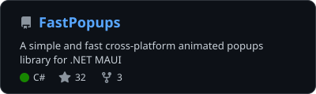
  </a>

   <a href="https://github.com/taublast/LightNavigation" style="flex:1 1 320px; max-width:420px;">
    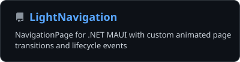
  </a>

   <a href="https://github.com/taublast/AppoMobi.Gestures" style="flex:1 1 320px; max-width:420px;">
    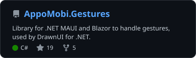
  </a>

  <a href="https://github.com/taublast/Plugin.Maui.ApplePlatform" style="flex:1 1 320px; max-width:420px;">
    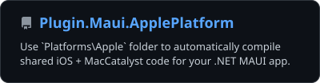
  </a>

  <a href="https://github.com/taublast/FluentColors.Maui" style="flex:1 1 320px; max-width:420px;">
    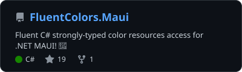
  </a>

  <a href="https://github.com/taublast/RustMaui" style="flex:1 1 320px; max-width:420px;">
    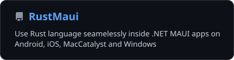
  </a>

### DrawnUI for .NET powered by SkiaSharp

  <a href="https://github.com/DrawnUi/DrawnUi.Net" style="flex:1 1 320px; max-width:420px;">
    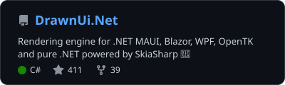
  </a>

  <a href="https://github.com/taublast/DrawnUi.Maui.Demo" style="flex:1 1 320px; max-width:420px;">
    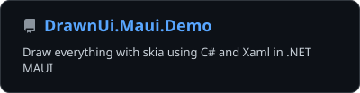
  </a>
  
  <a href="https://github.com/taublast/ShadersCarousel" style="flex:1 1 320px; max-width:420px;">
    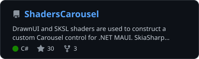
  </a>

  <a href="https://github.com/taublast/SurfAppCompareDrawn" style="flex:1 1 320px; max-width:420px;">
    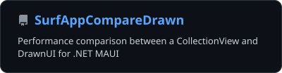
  </a>

  <a href="https://github.com/taublast/DrawnChatList" style="flex:1 1 320px; max-width:420px;">
    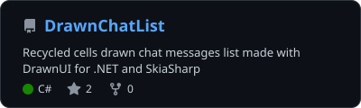
  </a>

  <a href="https://github.com/taublast/DrawnCells" style="flex:1 1 320px; max-width:420px;">
    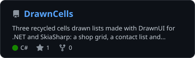
  </a>

### DrawnUI for React

  <a href="https://github.com/DrawnUi/DrawnUi.React" style="flex:1 1 320px; max-width:420px;">
    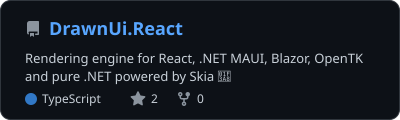
  </a>

### DrawnUI for Rust

  <a href="https://github.com/DrawnUi/DrawnUi.Rust" style="flex:1 1 320px; max-width:420px;">
    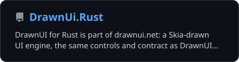
  </a>

  <a href="https://github.com/taublast/AgentSignals" style="flex:1 1 320px; max-width:420px;">
    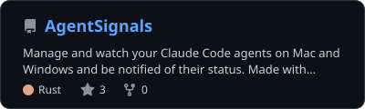
  </a>

  <a href="https://github.com/taublast/DrawnVpnClient" style="flex:1 1 320px; max-width:420px;">
    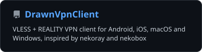
  </a>

### Camera Processing / AI

  <a href="https://github.com/taublast/DrawnUi.Camera" style="flex:1 1 320px; max-width:420px;">
    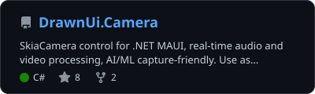
  </a>

   <a href="https://github.com/taublast/ShadersCamera" style="flex:1 1 320px; max-width:420px;">
    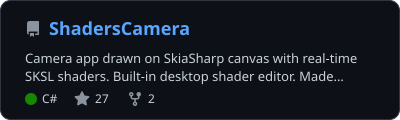
  </a>

  <a href="https://github.com/taublast/DetectFaces" style="flex:1 1 320px; max-width:420px;">
    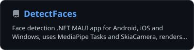
  </a>

  <a href="https://github.com/taublast/SolTempo" style="flex:1 1 320px; max-width:420px;">
    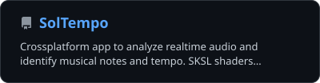
  </a>

### Create Games with .Net MAUI and Blazor

  <a href="https://github.com/taublast/Doom.Mobile" style="flex:1 1 320px; max-width:420px;">
    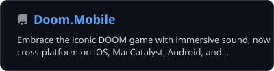
  </a>

  <a href="https://github.com/taublast/SpaceShooter" style="flex:1 1 320px; max-width:420px;">
    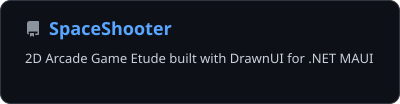
  </a>

  <a href="https://github.com/taublast/DrawnUi.Breakout" style="flex:1 1 320px; max-width:420px;">
    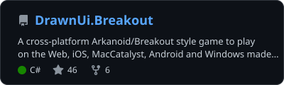
  </a>

  <a href="https://github.com/DrawnUi/DrawnUi.Dungeon.Net" style="flex:1 1 320px; max-width:420px;">
    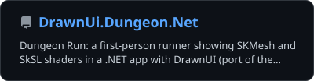
  </a>

